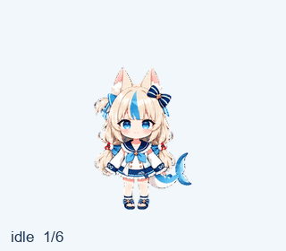
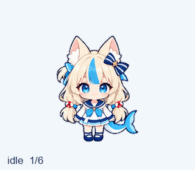

# Saba Pets 🐟

两套 Sameko Saba 动漫 Q 版宠物素材：细节丰富的 **Sameko Saba** 和便于小尺寸辨认的简化版 **Saba**。两套都包含九种动作及十六个转头方向，采用透明 v2 图集。

| Sameko Saba · 原版 | Saba · 简化版 |
| --- | --- |
|  |  |
| 较丰富的头发与服装细节 | 大脸、明显轮廓、简化服装 |

## 下载

- [两个版本打包下载](https://github.com/asukua/saba-pets/releases/download/v1.0.0/saba-pets-v1.0.0.zip)
- [只下载 Sameko Saba](https://github.com/asukua/saba-pets/releases/download/v1.0.0/sameko-saba-v1.0.0.zip)
- [只下载 Saba](https://github.com/asukua/saba-pets/releases/download/v1.0.0/saba-v1.0.0.zip)
- [发布页与校验文件](https://github.com/asukua/saba-pets/releases/tag/v1.0.0)

## 使用

解压后，选择对应宠物的 `spritesheet.png`。将这个 PNG 附给 Pets 插件，说明：“把这个完整 v2 图集加入宠物库，命名为 Sameko Saba / Saba。”每个账号导入后会得到自己的宠物记录。

也可直接取得 [Sameko Saba 图集](pets/sameko-saba/spritesheet.png) 或 [Saba 图集](pets/saba/spritesheet.png)，用于支持相同 v2 格式的导入工具。

## 文件

每套包含完整透明图集、动作 GIF/MP4 预览、转头循环、接触表、方向图、布局清单和生成提示词。`spritesheet.png` 是导入文件，其余图片和视频用于查看效果。

[图集格式与动作布局](docs/sprite-format.md) · [制作记录](docs/generation.md)

本项目是非官方 AI 同人素材，以 Sameko Saba 为灵感，由 ImageGen 生成并整理。
